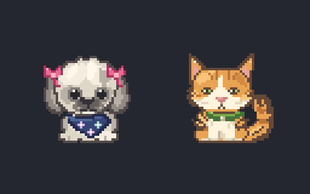

# pi-pet-emote

Meet **Mafe the dog** and **Leo the cat**, reactive pixel-art companions beside your [Pi](https://pi.dev) prompt. Choose either pet: 24 reactions follow local session events—thinking, tools, questions, and results—with no model calls.



Requires Node.js **22.19+** and an interactive Pi session. Image support depends on your terminal; ASCII is the fallback.

## Install

From npm:

```sh
pi install npm:pi-pet-emote
```

Or from GitHub:

```sh
pi install git:github.com/offluisangel/pi-pet-emote
```

Run `/reload` in Pi, then `/emote demo` to meet the pet. Choose one installation source, not both.

## Uninstall

For an npm installation:

```sh
pi remove npm:pi-pet-emote
```

For a GitHub installation:

```sh
pi remove git:github.com/offluisangel/pi-pet-emote
```

Run `/reload` in Pi to unload the extension.

## Commands

| Command | Action |
| --- | --- |
| `/emote` | List available reactions. |
| `/emote pet` | Choose Mafe or Leo; the active pet is marked. |
| `/emote <state>` | Preview a reaction. |
| `/emote demo` | Play the reaction sequence. |
| `/emote idle` | Stop the preview and return to idle. |

Choosing a different pet switches immediately and stops any preview. Canceling or choosing the active pet changes nothing. Reactions, `demo`, and `idle` use the selected pet in this and future sessions.

## License

[MIT](LICENSE). Original code by Eiji Onchi and efolchmontiel; contributions by offluisangel.
